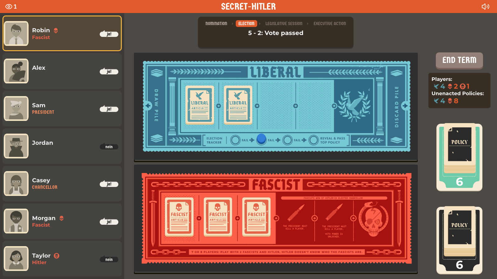
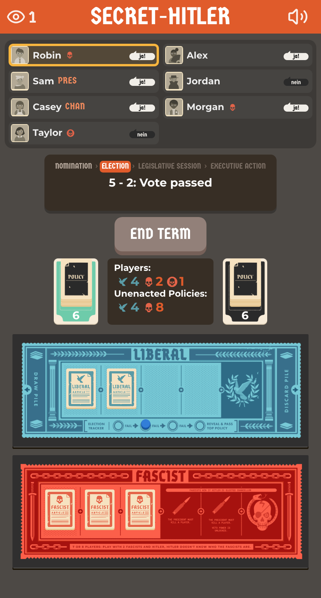

# Secret-Hitler-Online (self-hosted fork)

> **This is a personal fork** of [ShrimpCryptid/Secret-Hitler-Online](https://github.com/ShrimpCryptid/Secret-Hitler-Online),
> run as a private, self-hosted instance. It is not the hosted game at secret-hitler.online and is not
> maintained by the original author. Report problems with this fork on
> [its Issues page](https://github.com/jussaw/Secret-Hitler-Online/issues), not upstream.

<p>
  
  
</p>

A fan-made web adaptation of [Secret Hitler](https://secrethitler.com), a social deduction board game for up to 10 players by Goat, Wolf & Cabbage.

## The game

In the game, players are divided into Liberals, Fascists, and one secret Hitler. The Liberals must work together (or not) to discover the secret Hitler hiding in their midst, all while the Fascists try to elevate the secret Hitler to power. Pass policies to achieve victory and unlock presidential powers to investigate your friends.

Can you find and stop the Secret Hitler?

There are instructions on how to play the game provided in the app, and plenty of helpful tips are provided for first-time players. The game takes care of rules for you, making it easy to pick up and play. Lobbies with fewer than 5 players are filled with CPU players.

For more information, read the [official rulebook here](https://www.secrethitler.com/assets/Secret_Hitler_Rules.pdf).

## What this fork adds

- **A game screen that fits one screen.** The players are listed at the left, each with their office, any role you know and their vote. A round tracker over the boards lights the current step (nomination, election, legislative session, executive action) above the status line.
- **Phones.** A phone held upright gets one column: the players in two compact columns, the tracker, the decks and the boards. A ten-player game fits without scrolling at common sizes such as 360x740 and 412x915. Phones down to 320px wide keep the same layout, though the page may scroll on them.
- **Spectators.** Enter a lobby code and press **WATCH** to follow a game without a seat. Spectators see the table and the status lines, but no roles, hands or peeks until the game is over. The server filters those out, so they never reach a spectator's browser. Everyone sees how many people are watching.
- **A lobby that fits one screen.** It looks like the game screen: the players are listed at the left (ten fit), with the lobby code and invite link, a COPY button and the buttons for your role beside them. The status line says what START GAME is waiting for, such as which players still have to pick a look, and says when CPU players will fill the table.
- **Switching between playing and watching.** In the lobby, WATCH INSTEAD gives up your seat and follows the game as a spectator, and a spectator's PLAY INSTEAD asks for a name and a look and takes a seat (it is off while the lobby is full). No need to leave and rejoin.
- **END TERM ends itself.** Once a president has nothing left to do in their term, END TERM flashes and a 10-second countdown runs beside it. At zero the server ends the term, even if the president's tab is closed, so the table never sits waiting for a president who forgot. The president can pause the countdown to keep the term open as long as they need, and resume it. Everyone, spectators included, sees the countdown and whether it is paused.
- **Sound effects** for joining, nominations, votes, policies, presidential powers and the end of the game. The speaker button in the header mutes them and sets the volume, and each browser remembers its own setting. Every clip is CC0, credited in [docs/SOUND-CREDITS.md](docs/SOUND-CREDITS.md).
- **Lobbies survive a restart.** The server backs up its lobbies to a SQLite file and restores them when it starts.
- **One image on one port.** The Java server also serves the web page. CI publishes a Docker image for `linux/amd64` and `linux/arm64`.
- **A current toolchain:** Vite, React 18 and TypeScript 5, with Vitest unit tests and Playwright browser tests on desktop Chrome, Firefox and two emulated phones.
- **Fixes** for bugs carried over from upstream:
  - The lobby tagged every guest as `[Host]`.
  - A game started within 3 s of someone leaving or reloading seated a player who could never take the seat, and the game stalled at that seat's first turn. A game now seats only players who are connected.
  - A player who reloaded mid-game was locked out of their seat for 3 s.
  - A player whose network dropped for a moment (a phone changing networks, say) was sent to the login page and could not rejoin for about 30 s, because the server still held their dead connection. The page now gets straight back into its seat. It keeps retrying for about 30 s while the network is gone, and notices within 10 s a connection that died without a word, as on a phone waking up.
  - A request sent right after the server started could get a 404.
  - The console showed React warnings.
- **Removed:** Google Analytics, the Twitter share button, and upstream's Firebase and Fly.io deployment config. All 20 player portraits are available without sharing on Twitter.

The plan behind these changes, phase by phase, is in [docs/PLAN.md](docs/PLAN.md).

## Hosting your own

Run the published image and open [localhost:8080](http://localhost:8080):

```bash
docker run -d --name secret-hitler -p 8080:8080 -v sh-data:/data ghcr.io/jussaw/secret-hitler-online:latest
```

- The container serves plain HTTP on port 8080 (set `PORT` to change it). To play over the internet, put it behind a reverse proxy that terminates TLS and passes WebSocket upgrades through, since the game runs over a WebSocket at `/game`. On an `https:` page the client connects with `wss:`.
- Lobby backups go to `/data/backup.db` (`DATABASE_PATH`), so mount a volume, or a directory owned by uid 1000, at `/data`.
- Each push to `development` publishes `:latest` and `:sha-<short>`. For a health check, use `GET /ping`.
- To build the image yourself, run `docker build -t secret-hitler-online .` at the repo root.

## Running locally

Requirements: Java 17 and Node.js 22.12 or newer (tested with Node 24).

Start the backend, which listens on [localhost:4040](http://localhost:4040):

```bash
cd backend
./gradlew runLocal
```

In a second terminal, start the frontend dev server on [localhost:3000](http://localhost:3000):

```bash
cd frontend
npm install
npm run dev
```

Open [localhost:3000](http://localhost:3000), create a lobby, choose a look and start the game.

Run the tests with `cd backend && ./gradlew test` and `cd frontend && npm test -- --run`. See [DEVELOPMENT.md](DEVELOPMENT.md) for more setups, including Docker Compose and the browser tests.

## How it's built

- The Java 17 server uses [Javalin](https://javalin.io/) and is divided into the [game simulation](backend/src/main/java/game) (rules and CPU players) and the [server](backend/src/main/java/server) (HTTP endpoints, the `/game` WebSocket, lobbies and the SQLite backup).
- The [webpage](frontend) is written in [React](https://react.dev/) and TypeScript and built with [Vite](https://vite.dev/). Its animations are CSS. Assets were either adapted from the original board game or created using [Inkscape](https://inkscape.org/). The header icons come from [Lucide](https://lucide.dev/).
- The tests are JUnit 4 for the server, Vitest for the page, and Playwright for the whole app in real browsers.

## Licence and attribution

Secret Hitler Online is licensed under [Creative Commons BY-NC-SA 4.0](https://creativecommons.org/licenses/by-nc-sa/4.0/) (see [LICENSE](LICENSE)), and is adapted from the original board game released by Goat, Wolf & Cabbage (© 2016-2020). This fork is distributed under the same licence: non-commercial, share-alike.

The web adaptation was created by [ShrimpCryptid](https://github.com/ShrimpCryptid) (© 2020-2023) in [Secret-Hitler-Online](https://github.com/ShrimpCryptid/Secret-Hitler-Online). All credit for the original web game goes to its author and contributors.

*(This project is not affiliated with or endorsed by Goat, Wolf & Cabbage.)*

### What's changed from the original board game?

- Artwork for the boards, policy deck, identity cards, party cards, and liberal/fascist icons were adapted for the website with some minor modifications (rounding corners, adding depth, shadows).
- Custom assets (made in Inkscape) were added based on the style of the original, most notably for the election tracker, policy reveal popup windows, and the player icons and tiles.
- Where possible, fonts were replaced with ones licensed under the [Open Font License](https://scripts.sil.org/cms/scripts/page.php?site_id=nrsi&id=OFL), namely [Germania One](https://fonts.google.com/specimen/Germania+One) and [Montserrat](https://fonts.google.com/specimen/Montserrat).
- The web interface, animations, and server are new additions that use the same rules from the original game.
