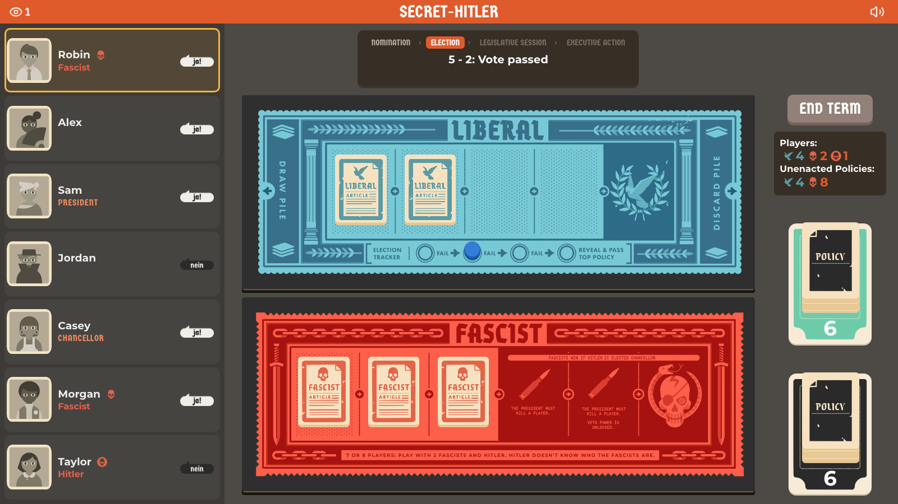
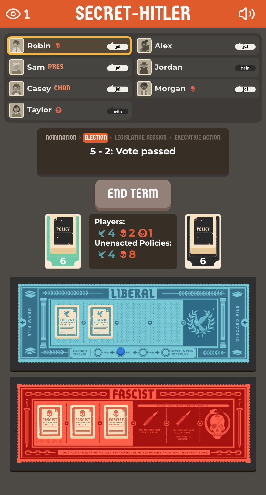
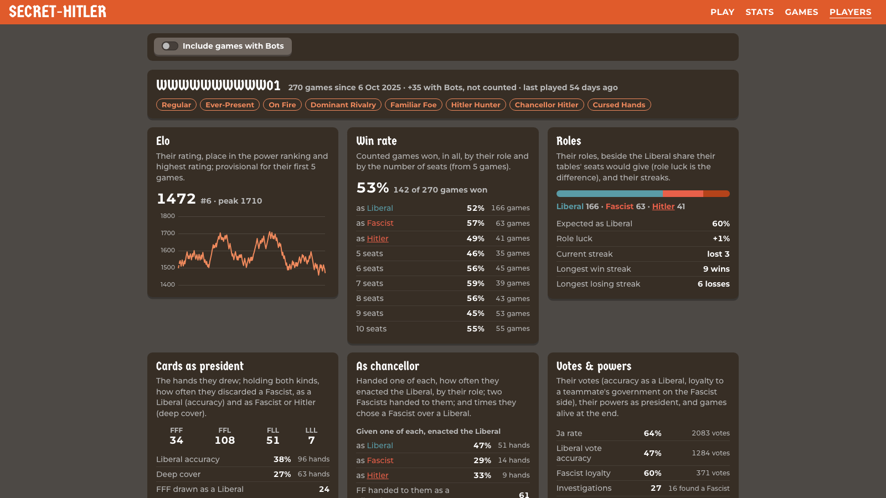
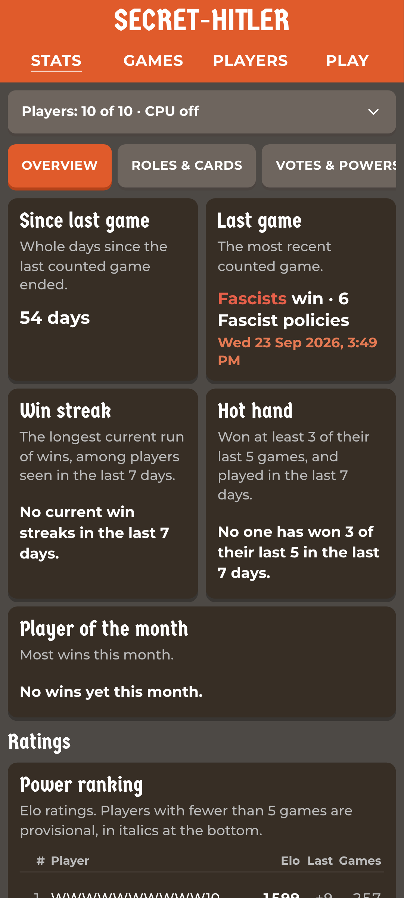

# Secret-Hitler-Online (self-hosted fork)

**Live site: [secret-hitler.jussaw.com](https://secret-hitler.jussaw.com/)**

> **This is a personal fork** of [ShrimpCryptid/Secret-Hitler-Online](https://github.com/ShrimpCryptid/Secret-Hitler-Online),
> run as a private, self-hosted instance. It is not the hosted game at secret-hitler.online and is not
> maintained by the original author. Report problems with this fork on
> [its Issues page](https://github.com/jussaw/Secret-Hitler-Online/issues), not upstream.

<p>
  
  
</p>

A fan-made web adaptation of [Secret Hitler](https://secrethitler.com), a social deduction board game for up to 10 players by Goat, Wolf & Cabbage.

## The game

In the game, players are divided into Liberals, Fascists, and one secret Hitler. The Liberals must work together (or not) to discover the secret Hitler hiding in their midst, all while the Fascists try to elevate the secret Hitler to power. Pass policies to achieve victory and unlock presidential powers to investigate your friends.

Can you find and stop the Secret Hitler?

There are instructions on how to play the game provided in the app, and plenty of helpful tips are provided for first-time players. The game takes care of rules for you, making it easy to pick up and play. Lobbies with fewer than 5 players are filled with CPU players, and the host can add more, up to a table of 10, and choose how well they play.

For more information, read the [official rulebook here](https://www.secrethitler.com/assets/Secret_Hitler_Rules.pdf).

## What this fork adds

- **A game screen that fits one screen.** The players are listed at the left, each with their office, any role you know and their vote. A round tracker over the boards lights the current step (nomination, election, legislative session, executive action) above the status line. It is the only cue when the phase changes: no banner crosses the screen or holds up the next prompt.
- **Phones.** A phone held upright gets one column: the players in two compact columns, the tracker, the decks and the boards. A ten-player game fits without scrolling at common sizes such as 360x740 and 412x915. Phones down to 320px wide keep the same layout, though the page may scroll on them.
- **Accounts, with Discord sign-in.** Playing needs an account: sign in with Discord, then choose a name of your own, which is what others see in lobbies and games. Nothing from Discord is shown to anyone else; only you see which Discord account you signed in with. Names are unique, ignoring case. Change yours from the login page or the lobby as often as you like, outside a game, and everyone in the lobby sees it at once. A sign-in lasts 30 days, renewed as you play, and survives a server restart, so a player goes back to their seat still signed in. Each game knows which account holds every seat. Watching needs no account.
- **Spectators.** Enter a lobby code and press **WATCH** to follow a game without a seat, signed in or not. Spectators see the table and the status lines, but no roles, hands or peeks until the game is over. The server filters those out, so they never reach a spectator's browser. Everyone sees how many people are watching.
- **A lobby that fits one screen.** It looks like the game screen: the players are listed at the left (ten fit), with the lobby code and invite link, a COPY button and the buttons for your role beside them. The status line says what START GAME is waiting for, such as which players still have to pick a look, and how many CPU players will join.
- **The host chooses how many bots play.** Beside START GAME, the host's − 2 BOTS + sets how many CPU players join, from the fewest that make a table of 5 to as many as fill it to 10. Everyone in the lobby sees each bot as a dashed row under the people, with the name it will play under, and the heading counts every seat. A bot gives up its seat to a person who joins, so the lobby is only full with 10 people, a bot joins when someone leaves a table that would drop below 5, and the host's number comes back when there is room for it again. The host's choice stays for the next game.
- **The host chooses how well the bots play.** Under START GAME's row, the host's BOT SKILL row sets EASY, NORMAL (the default) or HARD for every bot in the next game. Easy bots sometimes make a random move; Normal bots play as the bots always have, with their bugs fixed; Hard bots read more of the game (who has been cleared, how people voted, the cards they are handed and the odds of the deck), and Hard fascists bluff. No level sees anything a person in its seat could not. Everyone else in the lobby sees the level on a line in the same place, and the choice stays for the next game.
- **A plain login page that fits one screen.** Its first card signs you in, or shows your name with CHANGE NAME and Sign out. JOIN needs you signed in and a lobby code, CREATE LOBBY only the sign-in, and WATCH only the code. It has the lobby's look under the stats pages' header, whose STATS, GAMES and PLAYERS open the stats, and links to the official rules, this project and its issues, and one credit line. An invite link previews in chat as one plain line.
- **Switching between playing and watching.** In the lobby, WATCH INSTEAD gives up your seat and follows the game as a spectator, and a signed-in spectator's PLAY INSTEAD takes a seat under their name and asks for a look (it is off while the lobby is full). A spectator who is not signed in gets SIGN IN TO PLAY, which comes back to watching the same lobby. No need to leave and rejoin.
- **END TERM ends itself.** Once a president has nothing left to do in their term, END TERM flashes and a 10-second countdown runs beside it. At zero the server ends the term, even if the president's tab is closed, so the table never sits waiting for a president who forgot. The president can pause the countdown to keep the term open as long as they need, and resume it. Everyone, spectators included, sees the countdown and whether it is paused.
- **Sound effects** for joining, nominations, votes, policies, presidential powers and the end of the game. The speaker button in the lobby's and the game's header mutes them and sets the volume, and each browser remembers its own setting. Every clip is CC0, credited in [docs/SOUND-CREDITS.md](docs/SOUND-CREDITS.md).
- **Stats from every game.** The server records every game that ends, and every one abandoned when its lobby times out: the seats, roles and result, and a timeline of every nomination, vote, hand of cards, policy and power, with times, written once and only after the game is over. Players appear by a number tied to their account, never a Discord ID, and `/api/stats/games` serves the records. The stats pages, at `/stats`, read them:
  - **Seven tabs**, each with its own address: OVERVIEW (the days since the last game, the last game, win streaks, the hot hand, the player of the month, the power ranking and rating history, the headline numbers and the latest games), ROLES & CARDS (role splits and how lucky the deal was, win rates by role and table size, the hands drawn and what each player discarded and enacted), VOTES & POWERS (elections, Ja rates, how often a Liberal's vote was right, Fascist loyalty, investigations, executions and survival), RIVALS (the best duos, the closest and most lopsided rivalries, each player's nemesis and favourite opponent), ENDINGS (how games end by table size, how long they last, the closest and most lopsided boards), ACTIVITY (when the group plays, in your own time zone, and how long each player takes to decide) and RECORDS (streaks, best weeks and months, every month's player of the month, the longest game nights, the highest Elo and the biggest upset).
  - **A player filter and a Bots switch** over the tabs: a chip per player, all on by default, where a game counts only when everyone in it is on, and a switch, "Include games with Bots", that counts games with CPU players, left out by default. Unfinished games never count. The filter lives in the address, so it carries across the tabs and in a shared link, and on phones it folds into one line.
  - **Elo** for every player over the counted games: the two sides' ratings are averaged, the Fascists get a handicap learned from the group's earlier games of each player count, and a player is provisional for their first 5 games.
  - **GAMES and each game's timeline.** `/games` lists every recorded game, newest first, 20, 50 or 100 to a page, with a filter of its own (player, date, number of seats, ending and Bots) in the address. A game with bots is tagged with their level, Easy, Normal or Hard (games recorded before levels were kept say only Bots). Each game's page, `/games/<id>`, has its result, seats and Elo change, then every round: the government, the votes by name, the cards each player held and chose, vetoes, powers and how long each decision took.
  - **PLAYERS and a page for each player.** `/players` lists every player by name with their games, win rate, Elo and when they last played, sorts by any column at a press on its heading, and finds a player with a search box beside the Bots switch (it has no player filter). A player's page shows their trophies (fifteen, from Regular to Speed Demon, worked out from the stats), their Elo and its history, win rates, roles and streaks, cards, votes and powers, the people they play with and against, how long they take to decide and their latest games, with a link to all their games in GAMES. Its Bots switch stands alone: a player's page ignores the player filter.
  - **Tables that sort.** Like PLAYERS, every leaderboard card, the power ranking and the best weeks and months sort by any column at a press on its heading, and a second press turns the order round, while each player keeps their rank. On phones and in tall windows a card's count column moves under each name, so the count sorts only on a wider screen.
  - **Names that link.** A player's name anywhere in the stats opens their page.
  - **Links in.** The login page shares the stats pages' header, so the stats are a click from the top of the home page, and the victory screen's "See this game" opens the game just played.
  - **Database backups.** A script takes a checked snapshot of the server's SQLite file (lobbies, accounts and game records) while the server runs, keeps a month of them and can copy each one off the host; another puts one back. See [Backups](#backups).
- **Lobbies and sign-ins survive a restart.** The server backs up its lobbies to a SQLite file, which also holds the accounts and sessions, and restores them when it starts.
- **One image on one port.** The Java server also serves the web page. CI publishes a Docker image for `linux/amd64` and `linux/arm64`.
- **A current toolchain:** Vite, React 18 and TypeScript 5, with Vitest unit tests and Playwright browser tests on desktop Chrome, Firefox and two emulated phones.
- **Fixes** for bugs carried over from upstream:
  - The lobby tagged every guest as `[Host]`.
  - A game started within 3 s of someone leaving or reloading seated a player who could never take the seat, and the game stalled at that seat's first turn. A game now seats only players who are connected.
  - A player who reloaded mid-game was locked out of their seat for 3 s.
  - A player whose connection dropped twice within 3 s could lose their place early: the server freed it 3 s after the first drop, however recently the second came. In a lobby they lost their seat and portrait; in a game, their place in the lobby list. Each drop now gets its own 3 s.
  - A player whose network dropped for a moment (a phone changing networks, say) was sent to the login page and could not rejoin for about 30 s, because the server still held their dead connection. The page now gets straight back into its seat. It keeps retrying for about 30 s while the network is gone, and notices within 10 s a connection that died without a word, as on a phone waking up.
  - A player who came back to a game more than 3 s after dropping out (a phone whose screen went off, say) was left out of the lobby when the game ended: not listed, not counted, and given no seat in the next game, which could then fail to start. After a server restart every player came back this way, so the lobby listed no one. A player who comes back is now listed again, at the end of the list, so a host who was away that long passes the role on.
  - A request sent right after the server started could get a 404.
  - A closed prompt could leave an empty black box on screen until a reload, mostly in Firefox, over the board and in the way of END TERM. A closed prompt is now taken off the page once its fade-out ends.
  - Presses on buttons sometimes did nothing. A click on a button's shadow missed it, and so did a click near its top, because a press moved the button down out from under the pointer. For a second after a prompt closed, its fading overlay also swallowed every press, such as the president's END TERM right after the policy alert's OKAY. In Firefox, buttons also slid into place for a moment whenever a page appeared. The header's speaker came down from the middle of the window and END TERM shrank to its size, so a press near a button's edge could miss it. Every drawn part of a button now takes the press, a held press stays on its button, a closing prompt lets presses through, and buttons appear in place.
  - The console showed React warnings.
- **Removed:** Google Analytics, the Twitter share button, and upstream's Firebase and Fly.io deployment config. All 20 player portraits are available without sharing on Twitter. The login page no longer carries upstream's bots announcement, its pitch, GIFs of its old game screen or its links, and an invite link's preview no longer shows upstream's text and picture.

<p>
  
  
</p>

The plan behind these changes, phase by phase, is in [docs/PLAN.md](docs/PLAN.md).

## Hosting your own

Run the published image and open [localhost:8080](http://localhost:8080):

```bash
docker run -d --name secret-hitler-online -p 8080:8080 -v sh-data:/data ghcr.io/jussaw/secret-hitler-online:latest
```

- The container serves plain HTTP on port 8080 (set `PORT` to change it). To play over the internet, put it behind a reverse proxy that terminates TLS and passes WebSocket upgrades through, since the game runs over a WebSocket at `/game`. On an `https:` page the client connects with `wss:`.
- Lobby backups, accounts, sign-ins and game records go to `/data/backup.db` (`DATABASE_PATH`), so mount a volume, or a directory owned by uid 1000, at `/data`. Without one, every restart signs everyone out, forgets their names and loses the records.
- The server keeps that file in SQLite's WAL mode, with `backup.db-wal` and `backup.db-shm` beside it, so `/data` must be on a local disk, not a network share. Never copy the file by hand while the server runs: back it up with the script below.
- Each push to `development` publishes `:latest` and `:sha-<short>`. For a health check, use `GET /ping`.
- To build the image yourself, run `docker build -t secret-hitler-online .` at the repo root.

### Discord sign-in

Playing needs an account, and accounts are made by signing in with Discord. Without it set up, the login page says "Sign-in is not set up on this server.": anyone can watch, but nobody can play, and the server logs a warning at start. To set it up:

1. Create an application in the [Discord Developer Portal](https://discord.com/developers/applications).
2. Under its OAuth2 settings, add the redirect `https://<host>/auth/discord/callback`, where `<host>` is the address players open the game at.
3. Give the container the application's client ID and client secret, and that same redirect URL:

   | Variable | Value |
   |---|---|
   | `DISCORD_CLIENT_ID` | The application's client ID |
   | `DISCORD_CLIENT_SECRET` | Its client secret. Keep it out of the repo and out of your shell history, in an env file say (`docker run --env-file …`) |
   | `DISCORD_REDIRECT_URI` | `https://<host>/auth/discord/callback`, exactly as registered |

Sign-in is on once all three are set. The server asks Discord only for `identify` and keeps the Discord user ID, username and avatar. It uses Discord's token for that one read and never stores it, and it keeps only a hash of each session's token. Some things follow from `DISCORD_REDIRECT_URI`:

- The server takes it as its own address. A player's WebSocket from any other origin is refused, so players must open the game at that `<host>`.
- When it starts with `https:`, the session cookie is marked `Secure`, so the game must be served over HTTPS (at the proxy).

`TEST_SIGN_IN=true` turns on a TEST SIGN-IN button that signs anyone in as a test account, with no Discord. It is for local runs and the browser tests only; never set it on a server other people can reach.

### Backups

Two scripts in `devops/` back up the database from the running container and put a backup back. They run on the host, need only `docker` and `sha256sum` (or `shasum`), and work on the container by its name, `secret-hitler-online` unless you set another.

1. Copy `devops/.env.example` to `devops/.env` (which git ignores) and set `BACKUP_DIR` to an existing directory, as an absolute path.
2. Run `devops/backup-db.sh`. It takes one consistent snapshot inside the container while the server keeps writing (`VACUUM INTO`), checks it (`PRAGMA integrity_check` must say `ok`), copies it out, checks that its SHA-256 still matches, and moves it into `BACKUP_DIR` as `secret-hitler-<UTC time>.db`, with `secret-hitler-<UTC time>.db.sha256` beside it (`sha256sum -c` checks it there). If anything fails before that, it exits 1 and leaves no backup behind. Then it deletes the backups older than `RETENTION_DAYS`, and nothing else in the directory.
3. Schedule it, for example nightly at 04:00 from the crontab of a user who can run `docker`:

   ```
   0 4 * * * /path/to/Secret-Hitler-Online/devops/backup-db.sh >>/path/to/backup.log 2>&1
   ```

   Each failure ends with an `Error: …` line and a non-zero exit. With the output going to a log, cron sends no mail; to have cron mail failures where its mail is set up, leave out `2>&1`, so the errors reach cron. Cron's `PATH` is short, so check that it finds `docker`.

The settings, in `devops/.env` or the environment (which wins); an empty value means the default:

| Setting | Default | Used by |
|---|---|---|
| `CONTAINER_NAME` | `secret-hitler-online` | both |
| `DB_PATH` | `/data/backup.db` (the image's `DATABASE_PATH`) | both |
| `BACKUP_DIR` | none; required | backup |
| `RETENTION_DAYS` | `30` | backup |
| `AFTER_BACKUP` | empty (no hook) | backup |
| `STARTUP_TIMEOUT_SECONDS` | `120` | restore |

A backup kept on the same host does not survive losing that host. `AFTER_BACKUP` is a command run after each backup, with the new backup's path as `$1`, for copying it elsewhere: `AFTER_BACKUP=cp "$1" "$1.sha256" /path/to/another/disk/`, or an `scp` or `rsync` to another machine. If it fails, the backup is kept and the script exits non-zero.

To restore, best between games, run `devops/restore-db.sh <file>` with a backup and its `.sha256` beside it. Before it stops anything, it refuses a file that is not SQLite, or one whose `.sha256` is missing or does not match. Then it asks you to type the container's name, stops the container, swaps the file in from a one-off container of the same image, starts it again and waits until the server says it is listening (up to `STARTUP_TIMEOUT_SECONDS`). If the swap fails, the old database is left as it was and the container starts on it. The restored file brings back everything as it was at the backup: the accounts, names and sign-ins (so a sign-in or a name change made since is gone, and that player signs in or chooses again), the game records (so a game played since is gone from them), and the lobbies, of which those idle for more than 10 minutes are swept at start. A lobby whose game had already ended and been recorded when the backup was taken comes back without it, so a finished game is never played on.

### Known limits

- A game that is running when a server first starts with accounts is dropped, since its seats belong to typed names that no account can take back. Lobbies that are not in a game are kept. Deploy between games.
- Anyone with a Discord account can sign in. There is no allow-list.
- Signing out leaves the sockets already open connected until they close.
- There is no way to delete an account.
- One browser holds one sign-in, shared by all its tabs, so two people cannot play from two tabs of one browser. A second tab that joins a lobby the first is in is refused.
- Backups stay on the host unless `AFTER_BACKUP` copies them elsewhere.
- Going back to an image from before accounts: that server ignores the accounts, but a lobby it restores from a newer backup refuses every join until it times out, after 10 minutes. New lobbies work at once. Deleting the backup file clears the old lobbies sooner, but the same file holds the accounts.

## Running locally

Requirements: Java 17 and Node.js 22.12 or newer (tested with Node 24).

Start the backend, which listens on [localhost:4040](http://localhost:4040):

```bash
cd backend
./gradlew runLocal
```

In a second terminal, start the frontend dev server on [localhost:3000](http://localhost:3000):

```bash
cd frontend
npm install
npm run dev
```

Open [localhost:3000](http://localhost:3000), press **TEST SIGN-IN** (`runLocal` turns on the test sign-in, so no Discord application is needed), choose a name, create a lobby, choose a look and start the game. Lobbies with fewer than 5 players are filled with CPU players. One browser holds one sign-in, so for more players use private windows or other browsers; [DEVELOPMENT.md](DEVELOPMENT.md) also covers trying Discord sign-in locally.

Run the tests with `cd backend && ./gradlew test` and `cd frontend && npm test -- --run`. See [DEVELOPMENT.md](DEVELOPMENT.md) for more setups, including Docker Compose and the browser tests.

## How it's built

- The Java 17 server uses [Javalin](https://javalin.io/) and is divided into the [game simulation](backend/src/main/java/game) (rules and CPU players) and the [server](backend/src/main/java/server) (HTTP endpoints, the `/game` WebSocket, lobbies, accounts with Discord sign-in, and the SQLite file that backs them up).
- The [webpage](frontend) is written in [React](https://react.dev/) and TypeScript and built with [Vite](https://vite.dev/). Its animations are CSS. Assets were either adapted from the original board game or created using [Inkscape](https://inkscape.org/). The header and lobby icons come from [Lucide](https://lucide.dev/).
- The tests are JUnit 4 for the server, Vitest for the page, and Playwright for the whole app in real browsers.

## Licence and attribution

Secret Hitler Online is licensed under [Creative Commons BY-NC-SA 4.0](https://creativecommons.org/licenses/by-nc-sa/4.0/) (see [LICENSE](LICENSE)), and is adapted from the original board game released by Goat, Wolf & Cabbage (© 2016-2020). This fork is distributed under the same licence: non-commercial, share-alike.

The web adaptation was created by [ShrimpCryptid](https://github.com/ShrimpCryptid) (© 2020-2023) in [Secret-Hitler-Online](https://github.com/ShrimpCryptid/Secret-Hitler-Online). All credit for the original web game goes to its author and contributors.

*(This project is not affiliated with or endorsed by Goat, Wolf & Cabbage.)*

### What's changed from the original board game?

- Artwork for the boards, policy deck, identity cards, party cards, and liberal/fascist icons were adapted for the website with some minor modifications (rounding corners, adding depth, shadows).
- Custom assets (made in Inkscape) were added based on the style of the original, most notably for the election tracker, policy reveal popup windows, and the player icons and tiles.
- Where possible, fonts were replaced with ones licensed under the [Open Font License](https://scripts.sil.org/cms/scripts/page.php?site_id=nrsi&id=OFL), namely [Germania One](https://fonts.google.com/specimen/Germania+One) and [Montserrat](https://fonts.google.com/specimen/Montserrat).
- The web interface, animations, and server are new additions that use the same rules from the original game.
